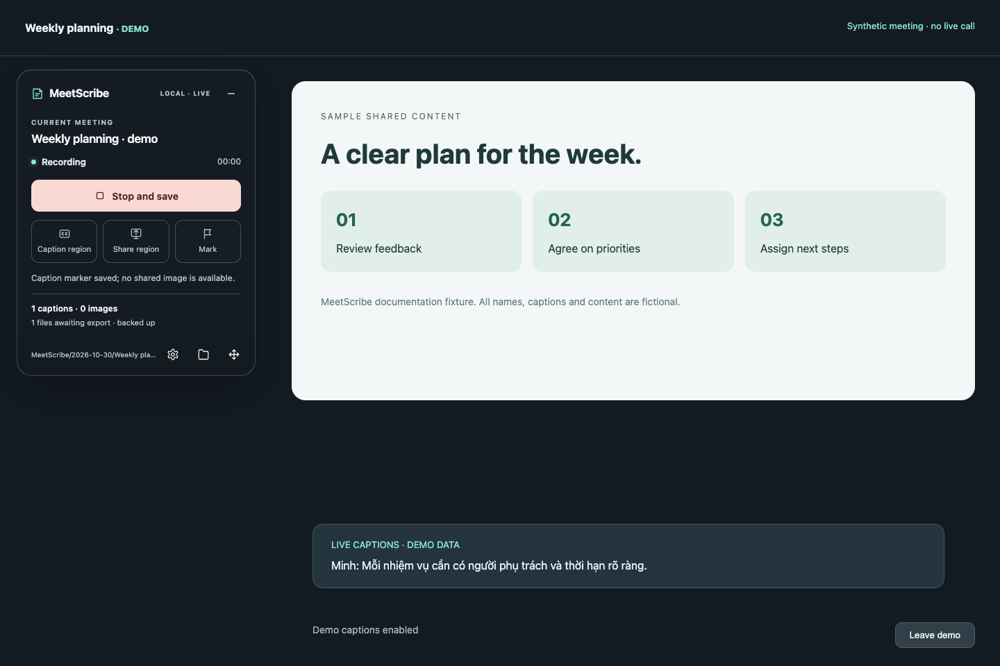
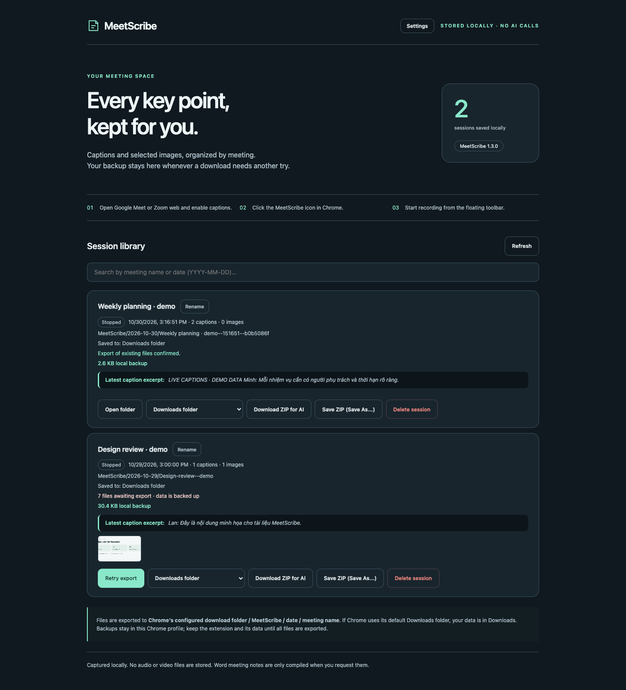
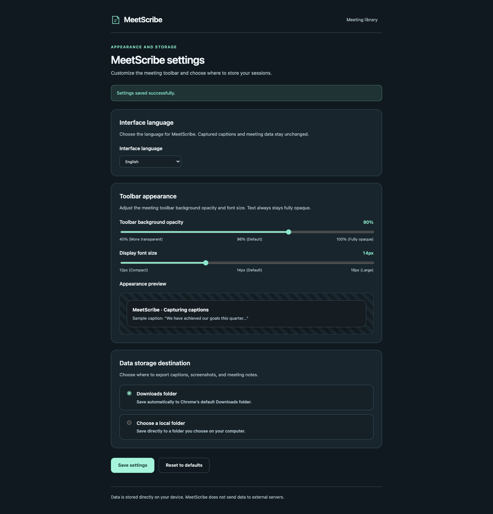

# MeetScribe

[Tiếng Việt](README.vi.md) · **English**

<p align="center">
  
</p>

<p align="center">
  <a href="https://github.com/b-ai-iot/MeetScribe/actions/workflows/ci.yml"></a>
  <a href="LICENSE"></a>
  <a href="CHANGELOG.md"></a>
  <a href="docs/en/installation.md"></a>
</p>

MeetScribe is an independent, local-first Chrome extension that captures live captions and shared-screen slides during Google Meet and Zoom web sessions. It operates entirely in your browser: no audio recording, no video file recording, and zero AI or external network calls during meetings. You choose where to export portable ZIP archives for later analysis.

> **UI Language Note:** The extension supports **Tiếng Việt** and **English**. Open **Cài đặt / Settings → Ngôn ngữ giao diện / Interface language**, choose a language, and click **Lưu cài đặt / Save settings**. Existing open pages and the toolbar update without restarting capture. Captions and meeting data stay in their original language.

---

## Key Features

- **DOM-Native Caption Capture:** Captures live captions from official Google Meet and Zoom web DOM elements with automatic reacquisition and journaled IndexedDB persistence. Speaker names can remain in raw text; the structured `speaker` field is currently `null`.
- **Smart Slide Sampling:** Captures user-confirmed presentation areas (15-second sample, minimum 30-second interval, perceptual deduplication via dHash64/color/region) without saving full video streams.
- **Flexible Local Storage:** Exports files automatically to Chrome's default `Downloads/MeetScribe/...` directory or to any custom folder chosen via the File System Access API.
- **AI-Ready ZIP Export:** Generates self-contained packages containing raw snapshots, slides, metadata, `transcript.md` (timestamped reading copy), and `README-for-AI.md` (structured instructions for external LLMs).
- **Session Management Library:** Search previous meetings by title or date, safely rename display titles, inspect local backup sizes, preview captions/slides, and re-export failed downloads.
- **Customizable Toolbar:** Translucent floating overlay with adjustable opacity (40–100%), scalable font size (12–18px), drag-and-drop repositioning, keyboard arrow controls, and compact mode.

---

## Screenshots

<p align="center">
  <br />
  <em>Floating toolbar overlay during a meeting session (synthetic Google Meet caption demonstration).</em>
</p>

<p align="center">
  <br />
  <em>Session library page (<code>library.html</code>) showing search, session cards, export status, and ZIP options.</em>
</p>

<p align="center">
  <br />
  <em>Settings page (<code>settings.html</code>) with opacity slider, font size preview, and local directory configuration.</em>
</p>

---

## Quickstart

MeetScribe is not distributed through the Chrome Web Store and provides no prebuilt release assets yet. You load it directly from source:

1. **Clone the repository:**
   ```bash
   git clone https://github.com/b-ai-iot/MeetScribe.git
   cd MeetScribe
   ```
2. **Open Extensions in Chrome:**
   Navigate to `chrome://extensions/` and enable **Developer mode** in the top right.
3. **Load Unpacked Extension:**
   Click **Load unpacked** and select the `extension/` directory inside this repository.
4. **Pin and Use:**
   Pin **MeetScribe** (the subtitle follows Chrome’s language) to your toolbar. Open a Google Meet or Zoom web tab, turn on native captions, and click the MeetScribe icon to display the floating controls.

To create a local zip package matching the repository manifest, run:
```bash
npm run package
```
This outputs `dist/MeetScribe-1.3.0.zip` containing the unpacked `MeetScribe/` folder with `manifest.json`.

---

## Scope & Honest Limitations

- **Platforms:** Supports Google Meet and Zoom on desktop Google Chrome (116+). The Zoom desktop application is **not** supported.
- **Native Captions Required:** Captions must be activated within the meeting interface. MeetScribe captures DOM text; it does not record microphone audio or perform speech-to-text transcription.
- **Mouse Selection:** Initial caption and share-screen region pickers require mouse interaction (hover, scroll to expand parent, click to select, Esc to cancel). Toolbar movement supports both mouse dragging and keyboard arrows.
- **Testing Boundaries:** Automated test suites run against synthetic DOM fixtures and platform OPFS handles. Testing does not substitute for real meeting environments or the native OS directory picker dialog.

---

## Documentation

Explore the comprehensive bilingual documentation in the [`docs/`](docs/README.md) directory:

- [Installation Guide](docs/en/installation.md) · Step-by-step setup, requirements, and permissions
- [Usage Guide](docs/en/usage.md) · Toolbar buttons, caption/share selection, and meeting workflows
- [Export Format](docs/en/export-format.md) · Directory layout, JSONL schema, and AI ZIP specifications
- [Privacy & Security](docs/en/privacy.md) · Local-first architecture, zero analytics, and permission audit
- [Development & Testing](docs/en/development.md) · Environment setup, Playwright tests, and packaging
- [Troubleshooting](docs/en/troubleshooting.md) · Solutions for common caption, permission, and export issues
- [Architecture](docs/en/architecture.md) · System design, service worker, content scripts, and data flow

---

## Contributing & License

Contributions are welcome in both English and Vietnamese. Please review [CONTRIBUTING.md](CONTRIBUTING.md) and our [CODE_OF_CONDUCT.md](CODE_OF_CONDUCT.md) before submitting issues or pull requests. For vulnerability disclosures, refer to [SECURITY.md](SECURITY.md).

MeetScribe is licensed under the [MIT License](LICENSE). Copyright &copy; 2026 MeetScribe contributors.
