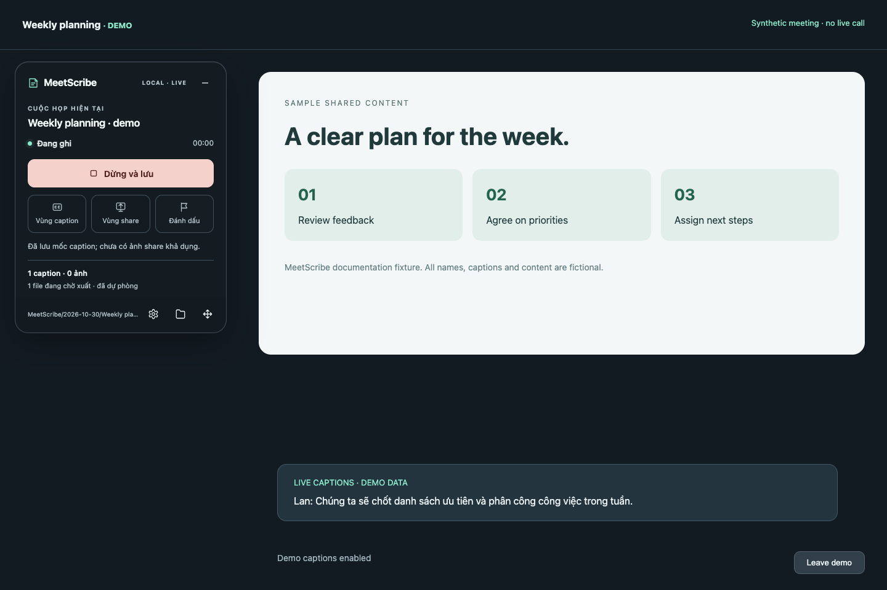
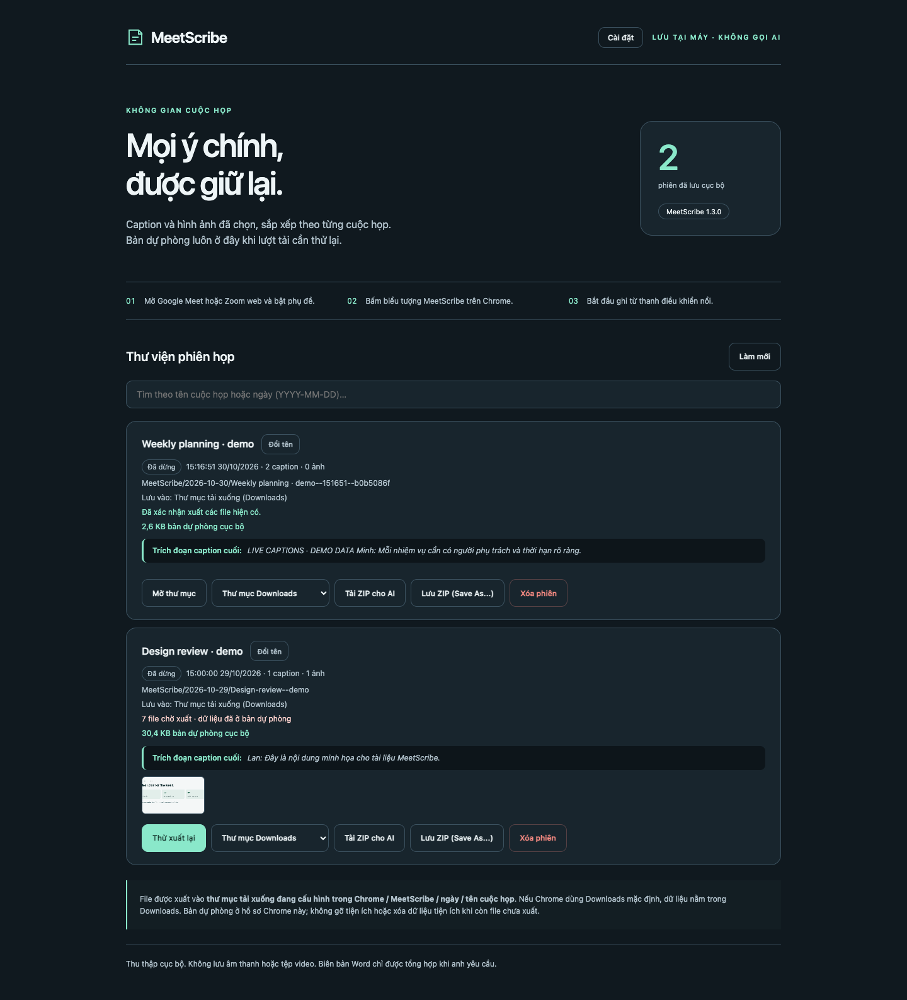
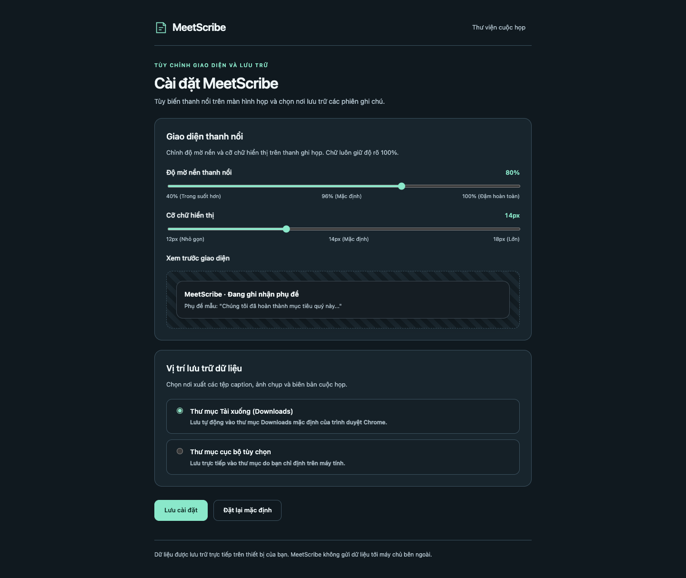

# MeetScribe

**Tiếng Việt** · [English](README.md)

<p align="center">
  
</p>

<p align="center">
  <a href="https://github.com/b-ai-iot/MeetScribe/actions/workflows/ci.yml"></a>
  <a href="LICENSE"></a>
  <a href="CHANGELOG.vi.md"></a>
  <a href="docs/vi/installation.md"></a>
</p>

MeetScribe là tiện ích mở rộng Chrome độc lập, ưu tiên lưu trữ cục bộ (local-first) giúp thu thập phụ đề trực tiếp và ảnh chụp màn hình trình chiếu trong các cuộc họp Google Meet và Zoom bản web. Tiện ích hoạt động hoàn toàn trong trình duyệt của bạn: không ghi âm âm thanh micro, không lưu tệp video và tuyệt đối không thực hiện bất kỳ lệnh gọi API AI hay kết nối máy chủ bên ngoài nào khi đang họp. Bạn nắm toàn quyền kiểm soát dữ liệu và có thể xuất gói ZIP chuẩn bị sẵn cho AI bất cứ lúc nào.

> **Ghi chú ngôn ngữ giao diện:** Tiện ích hỗ trợ **Tiếng Việt** và **English**. Mở **Cài đặt / Settings → Ngôn ngữ giao diện / Interface language**, chọn ngôn ngữ rồi bấm **Lưu cài đặt / Save settings**. Trang đang mở và thanh nổi cập nhật mà không khởi động lại việc thu. Caption và dữ liệu cuộc họp giữ nguyên ngôn ngữ gốc.

---

## Tính năng nổi bật

- **Thu phụ đề gốc:** Quan sát snapshot DOM, tự tìm lại khung và ghi journal IndexedDB. Tên người nói có thể nằm trong văn bản thô; trường `speaker` hiện luôn `null`.
- **Chụp ảnh slide thông minh:** Chụp vùng nội dung trình chiếu do bạn xác nhận (lấy mẫu 15 giây, khoảng cách tối thiểu 30 giây giữa các ảnh, khử trùng lặp qua dHash64/sai khác màu/lưới phân vùng) mà không lưu video toàn bộ màn hình.
- **Lưu trữ cục bộ linh hoạt:** Tự động xuất tệp vào thư mục `Downloads/MeetScribe/...` mặc định của Chrome hoặc vào bất kỳ thư mục nào trên máy tính qua File System Access API.
- **Xuất gói ZIP cho AI cầm tay:** Tạo gói nén độc lập chứa toàn bộ bản chụp thô, ảnh trình chiếu, siêu dữ liệu, tệp `transcript.md` (bản đọc phụ đề theo mốc thời gian) và `README-for-AI.md` (chỉ dẫn chi tiết chống bịa đặt cho mô hình ngôn ngữ lớn).
- **Thư viện quản lý phiên họp:** Tìm kiếm cuộc họp theo tên hoặc ngày, đổi tên hiển thị an toàn, kiểm tra dung lượng bản dự phòng cục bộ, xem trước trích đoạn phụ đề/ảnh thu nhỏ và thử xuất lại các lượt tải bị gián đoạn.
- **Thanh điều khiển tùy biến:** Thanh kính mờ nổi với khả năng chỉnh độ mờ nền (40–100%), cỡ chữ linh hoạt (12–18px), hỗ trợ kéo thả bằng chuột, di chuyển bằng phím mũi tên và chế độ thu nhỏ gọn gàng.

---

## Ảnh chụp giao diện

<p align="center">
  <br />
  <em>Thanh điều khiển nổi khi đang họp (ảnh chụp minh họa với phụ đề mô phỏng trên Google Meet).</em>
</p>

<p align="center">
  <br />
  <em>Trang Thư viện phiên họp (<code>library.html</code>) hiển thị tìm kiếm, thẻ cuộc họp, trạng thái xuất và tùy chọn ZIP.</em>
</p>

<p align="center">
  <br />
  <em>Trang Cài đặt (<code>settings.html</code>) với thanh chỉnh độ mờ, xem trước cỡ chữ và chọn thư mục cục bộ.</em>
</p>

---

## Bắt đầu nhanh

Tải `MeetScribe-1.3.0.zip` và `SHA256SUMS.txt` tại [release mới nhất](https://github.com/b-ai-iot/MeetScribe/releases/latest). [Kiểm tra checksum](docs/vi/releasing.md#kiểm-tra-file-tải-về), giải nén rồi tải thư mục `MeetScribe/` tại `chrome://extensions/` với chế độ dành cho nhà phát triển. Chưa phân phối qua Chrome Web Store.

Hoặc cài trực tiếp từ mã nguồn:

1. **Sao chép kho mã nguồn:**
   ```bash
   git clone https://github.com/b-ai-iot/MeetScribe.git
   cd MeetScribe
   ```
2. **Mở trang tiện ích trong Chrome:**
   Truy cập `chrome://extensions/` và bật mục **Chế độ dành cho nhà phát triển** (Developer mode) ở góc trên bên phải.
3. **Nạp tiện ích chưa giải nén:**
   Bấm **Tải tiện ích đã giải nén** (Load unpacked) và trỏ tới thư mục `extension/` trong kho mã nguồn này.
4. **Ghim và sử dụng:**
   Ghim **MeetScribe** (phần tên phụ theo ngôn ngữ Chrome) lên thanh tiện ích Chrome. Mở một tab Google Meet hoặc Zoom web, bật phụ đề và bấm biểu tượng MeetScribe để mở thanh điều khiển nổi.

Để đóng gói tệp ZIP cục bộ khớp với thông tin phiên bản của kho mã nguồn:
```bash
npm run package
```
Lệnh sẽ tạo tệp `dist/MeetScribe-1.3.0.zip` chứa thư mục `MeetScribe/` kèm tệp `manifest.json`.

---

## Phạm vi & Giới hạn thực tế

- **Nền tảng hỗ trợ:** Hoạt động trên Google Meet và Zoom bản web trong Google Chrome máy tính (116+). **Không** hỗ trợ ứng dụng Zoom desktop cài trên máy.
- **Yêu cầu bật phụ đề:** Phụ đề phải được bật trong giao diện cuộc họp. MeetScribe đọc văn bản từ DOM; tiện ích không ghi âm micro và không tự chuyển giọng nói thành văn bản.
- **Thao tác chuột khi chọn vùng:** Bộ chọn vùng phụ đề và vùng trình chiếu ban đầu yêu cầu thao tác bằng chuột (rê chuột, cuộn chuột để chọn khung cha, click để chọn, bấm Esc để hủy). Thanh điều khiển hỗ trợ cả kéo chuột lẫn phím mũi tên.
- **Giới hạn kiểm thử tự động:** Các bộ kiểm thử tự động chạy trên trang HTML mô phỏng và directory handle OPFS chuẩn. Kiểm thử tự động không thay thế việc kiểm tra trực tiếp trong cuộc họp thật hay hộp thoại chọn thư mục của hệ điều hành.

---

## Hệ thống tài liệu

Tham khảo các hướng dẫn chi tiết song ngữ trong thư mục [`docs/`](docs/README.md):

- [Hướng dẫn cài đặt](docs/vi/installation.md) · Các bước cài đặt, yêu cầu môi trường và quyền hạn
- [Hướng dẫn sử dụng](docs/vi/usage.md) · Thao tác nút bấm, chọn vùng phụ đề/ảnh và quy trình ghi họp
- [Cấu trúc file xuất](docs/vi/export-format.md) · Sơ đồ thư mục, cấu trúc tệp JSONL và gói ZIP cho AI
- [Quyền riêng tư & Bảo mật](docs/vi/privacy.md) · Kiến trúc cục bộ, không thu thập dữ liệu và phân tích quyền
- [Phát triển & Kiểm thử](docs/vi/development.md) · Cài đặt môi trường, chạy kiểm thử Playwright và đóng gói
- [Xử lý sự cố](docs/vi/troubleshooting.md) · Khắc phục lỗi nhận diện phụ đề, cấp lại quyền và xuất file
- [Kiến trúc hệ thống](docs/vi/architecture.md) · Thiết kế hệ thống, service worker, content scripts và luồng dữ liệu

---

## Đóng góp & Giấy phép

Mọi đóng góp bằng tiếng Anh hoặc tiếng Việt đều được hoan nghênh. Vui lòng đọc kỹ [CONTRIBUTING.vi.md](CONTRIBUTING.vi.md) và [CODE_OF_CONDUCT.vi.md](CODE_OF_CONDUCT.vi.md) trước khi gửi yêu cầu sửa đổi hoặc phản hồi. Về báo cáo bảo mật, vui lòng xem [SECURITY.vi.md](SECURITY.vi.md).

MeetScribe được phát hành theo [Giấy phép MIT](LICENSE). Bản quyền &copy; 2026 Nhóm đóng góp MeetScribe.

Xem [quản trị nhánh và quyền](docs/vi/governance.md) và [quy trình phát hành](docs/vi/releasing.md).
