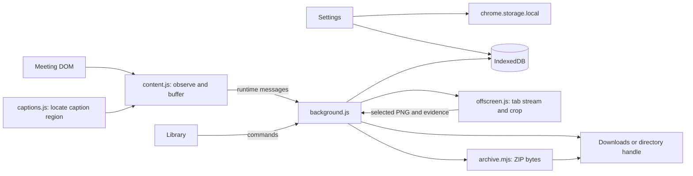

# Architecture

[Tiếng Việt](../vi/architecture.md) · [Documentation](../README.md)

MeetScribe is a Chrome Manifest V3 extension. It runs directly from `extension/` without a production bundler or runtime dependency. The following describes version 1.3.0.

## Components and data flow

| Component | Responsibility |
| --- | --- |
| [background.js](../../extension/background.js), [commands.mjs](../../extension/commands.mjs) | Route messages, serialize start/stop by tab, track frame routes, finalize sessions and schedule export |
| [content.js](../../extension/content.js) | Shadow DOM toolbar, native caption observation, in-memory batch queue, manual pickers and health checks |
| [captions.js](../../extension/captions.js), [captions.mjs](../../extension/captions.mjs) | Classic-script detector for injection and module wrapper for tests; score caption-specific visible regions and reject ambiguous/irrelevant sources |
| [store.mjs](../../extension/store.mjs) | IndexedDB transactions, session files, destination handles, scoped reads and bounded ZIP input reads |
| [downloads.mjs](../../extension/downloads.mjs), [destination.mjs](../../extension/destination.mjs) | Confirm downloads or write through a stored directory handle before marking journal files exported |
| [archive.mjs](../../extension/archive.mjs) | Serialize ZIP structures, CRC-32, optional native compression, transcript/AI instructions and entry manifest |
| [offscreen.js](../../extension/offscreen.js), [visual.mjs](../../extension/visual.mjs) | Receive a temporary tab video stream, crop selected region, compare frames, enforce sampling/budget rules and stop tracks |
| [frames.mjs](../../extension/frames.mjs), [install.mjs](../../extension/install.mjs) | Select the supported meeting frame, inject collector, route messages and translate Zoom iframe coordinates |
| [library.js](../../extension/library.js), [settings.js](../../extension/settings.js) | Session controls/preview/export, appearance settings, directory selection and permission repair |

Shadow DOM isolates styles, **not** untrusted code. The meeting page controls the DOM text being observed. Do not treat the overlay as a security boundary or the captured text as cryptographically authenticated.

## Session and command model

Persisted session statuses are `recording`, `stopping`, `completed` and `interrupted`. Idle/starting labels belong to UI state. Export progress is separate: pending files and `exportError` can remain even after a session has completed.

Content scripts and pages use `chrome.runtime.sendMessage`/`chrome.tabs.sendMessage`; they do not keep a long-lived port. Examples of actual worker command names are `start`, `stop`, `caption`, `mark`, `health`, `retry` and `export-zip`. Settings also read/write local preferences and directory handles directly in their extension page context.

## Persistence

Database `meetscribe-local-v1`, schema version 2, has three object stores:

- `sessions`: session metadata keyed by session ID.
- `files`: JSONL/PNG/JSON journal payloads, keyed by `<session-id>/<relative-file-name>`. Its `pending` index uses `[sid, state]`.
- `destination_handles`: directory handles and the active destination record.

Caption/image/event data are files inside `files`, not separate IndexedDB stores. Session file reads use a **string prefix range** (`id + '/'` through `id + '/\uffff'`). Export reads walk a scoped cursor and reject oversized accumulated payloads. Settings such as opacity and font size use separate `chrome.storage.local` keys.

The content queue drops a caption batch only after durable journal acknowledgement. The worker then attempts ordinary disk export. File export state changes after a completed Chrome download or a successful writable stream close. `finished.json` is journaled at finalization; it does not guarantee disk export success. See the [export reference](export-format.md).

## Capture and timing

Caption batches normally flush after 10 seconds or 100 updates. Source health is checked every 5 seconds; a recognized end screen must appear in two consecutive checks without a leave control. Silence alone does not end a session. A Chrome alarm retries pending exports every minute; it is not the caption batch timer.

After explicit share selection, `background.js` obtains a tab capture stream ID. `offscreen.js` uses `getUserMedia({audio:false,...})` to receive the **whole-tab stream in memory**, then crops the confirmed rectangle before saving PNGs. Small comparison frames remain in memory for deduplication until final stop. Automatic sampling is every 15 seconds, normally at least 30 seconds between saved images. Marks and stable-change review still respect duplicate/budget checks.

## ZIP and failure behavior

ZIP header/central-directory serialization and CRC-32 are JavaScript. Deflate, when available and useful, uses the browser's native `CompressionStream('deflate-raw')`; otherwise entries can be stored uncompressed. The manifest lists paths and byte counts, not SHA-256 digests. Source/derived payload guards are 500 MiB; this does not promise a fixed peak RAM requirement.

Custom destinations are pinned by ID for each session. Missing/revoked permission keeps ordinary files pending; the user can repair that handle or recover a ZIP to Downloads. Stop-and-ZIP finalizes/drains first and can still recover journal data when ordinary export fails. Storage/browser failures cannot recover captions never observed or never journaled. Tests and manual boundaries are described in [development](development.md) and [verification](../verification.md).
