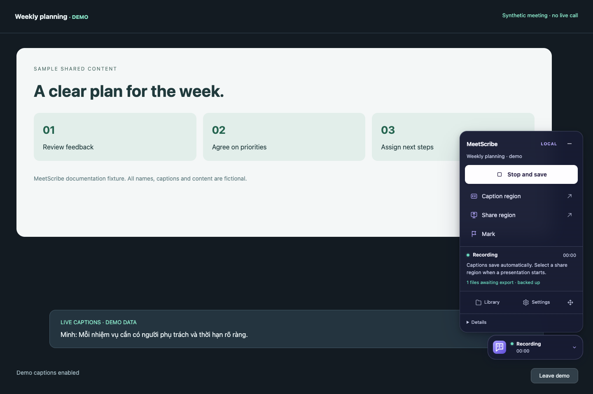
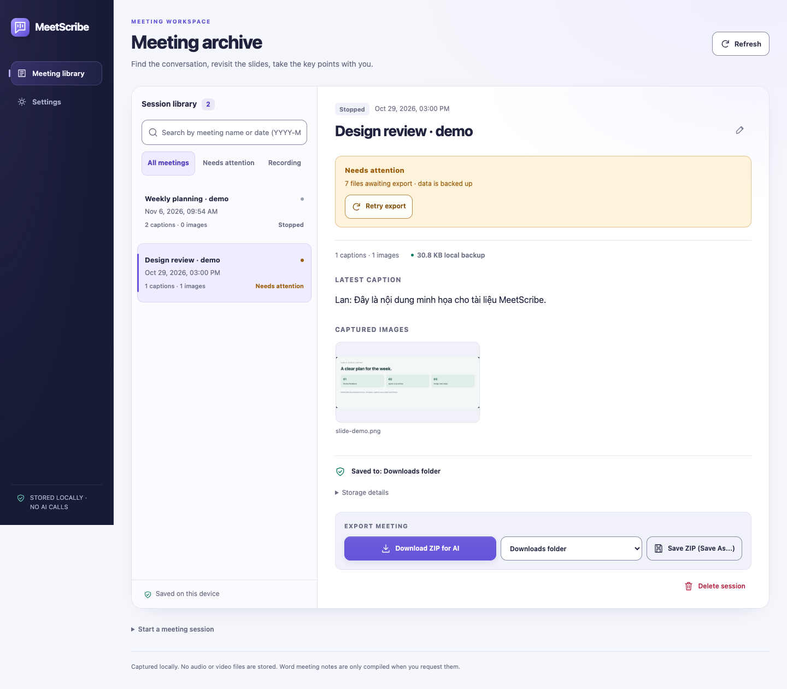
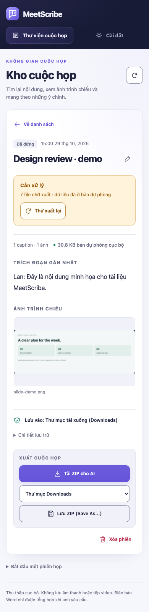
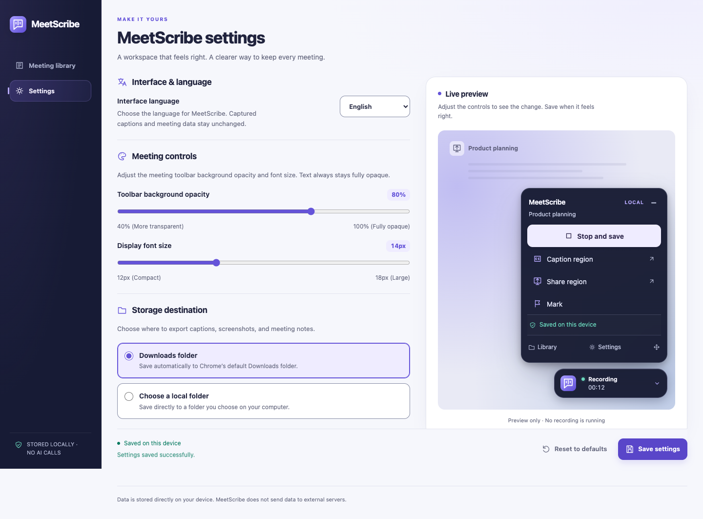

# Usage Guide

[Tiếng Việt](../vi/usage.md) · **English** · [Documentation Index](../README.md)

This comprehensive guide explains how to use MeetScribe during meetings, manage presentation slides, navigate the session library, and configure custom settings.

---

## Meeting Workflow Overview

   
  <em>MeetScribe floating toolbar during an active meeting (synthetic Google Meet demonstration).</em>

### Step 1: Turn On Native Captions Before Recording
Before starting MeetScribe, you must activate the meeting platform's native live closed captions:
- **Google Meet:** Click the closed-caption icon (**CC**) in the bottom control bar.
- **Zoom Web:** Click the **Captions** / **Show Captions** button on the bottom controls.

> **Important:** MeetScribe captures DOM text generated by the platform's speech recognition. It does not record audio or run local AI transcription. If captions are off, no transcript can be collected.

### Step 2: Open the Toolbar
Click the **MeetScribe** icon on your Chrome extensions toolbar. A compact floating button appears over your meeting tab. Click it (or press Enter/Space while focused) to open the controls. Fresh preferences start compact; an explicitly saved expanded preference is retained. The 232 × 60 capsule stays connected to its action menu when open. Secondary counters, storage paths and reset-position controls are under **Details**. During region selection the toolbar hides and a separate cancel strip remains.

### Step 3: Floating Toolbar Controls

The toolbar supports Vietnamese and English. The reference below maps both labels to the same action:

| Vietnamese Label | English Translation | Action & Behavior |
| :--- | :--- | :--- |
| `Bắt đầu ghi` | **Start recording** | Begins caption journaling. Auto-detects the caption container and creates an active session. |
| `Đang chuẩn bị…` | **Preparing…** | Transient status while initializing IndexedDB and session metadata. |
| `Dừng và lưu` | **Stop and save** | Stops recording, flushes all pending caption buffers, finalizes files, and exports to disk. |
| `Đang lưu…` | **Saving…** | Transient status while writing finalized journals to storage. |
| `Vùng caption` | **Caption region** | Manual picker fallback. Activates cursor inspection to highlight and select the caption container. |
| `Vùng share` | **Share region** | Prompts you to click the shared presentation/slide area. Starts background tab video sampling. |
| `Ngừng chụp vùng share` | **Stop capturing share region** | Stops visual slide sampling while continuing caption collection uninterrupted. |
| `Đánh dấu` | **Mark / Bookmark** | Saves an instant discussion timestamp in `events/` and attempts an immediate slide capture (duplicate, budget and availability checks still apply). |
| `Thu nhỏ` (`-`) | **Collapse** | Closes the control panel while keeping the floating button and capture active. Click the button to reopen; Escape also closes the panel and returns focus to the button. |
| `Di chuyển thanh điều khiển` | **Move toolbar** | Drag the floating button or movement handle; focus the button and use arrow keys. The reset-position action returns it to a reachable default location. Dragging does not open/close the panel. |
| `Cài đặt MeetScribe` | **Settings** | Opens `settings.html` to customize opacity, font size, or storage directory. |
| `Thư viện phiên họp` | **Session library** | Opens `library.html` to review, rename, re-export, or download AI ZIP packages. |
| `Thử lưu và tiếp tục` | **Retry and continue** | Rescue action displayed if an export write encounters a transient error. |
| `Cứu caption đang chờ` | **Rescue pending captions** | Emergency browser download triggered if the Chrome extension context was invalidated or reloaded. |

---

## Capturing Presentation Slides (`Vùng share`)

When a participant shares their screen:
1. Click **`Vùng share`** on the toolbar.
2. Hover your mouse strictly over the slide/presentation rectangle and click to confirm.
   - **Do NOT** select your entire browser window or webcam feeds.
   - Chrome prompts for tab capture permission; grant it to proceed.
3. **Sampling Logic:**
   - MeetScribe samples the video stream every **15 seconds**.
   - A new slide is saved only if it differs significantly from previous captures (evaluated via dHash64 perceptual hashing, RGB color shift, and 8&times;8 block diff).
   - Minimum interval between saved slides is normally **30 seconds** (unless forced by clicking `Đánh dấu`).
4. **Safety Budgets:** Maximum 30 images per hour, 120 images per session, and 100 MiB total image storage.
5. If the presenter stops sharing or moves the window, the toolbar alerts: *"Mất vùng share. Chọn lại vùng share; caption vẫn tiếp tục."* Caption capture continues without interruption.

---

## Session Library (`library.html`)

   
  <em>Session library page (synthetic demonstration sessions showing export status, backup size, and ZIP buttons).</em>

The library lists all past sessions stored in your browser's IndexedDB backup:
- **Search Bar (`Tìm theo tên cuộc họp hoặc ngày…`):** Filter by meeting name or date (`YYYY-MM-DD`).
- **`Đổi tên` (Rename):** Updates the display title in metadata. This does **not** move or rename existing files already written to disk.
- **Caption Tail & Image Preview:** Shows the last recorded caption snippets and captured slide thumbnails.
- **Backup Size:** Displays local storage bytes in IndexedDB.
- **`Thử xuất lại` (Retry export):** Re-attempts writing missing files to disk if an earlier download was interrupted.
- **`Cấp lại quyền thư mục` (Reauthorize folder):** Re-prompts for directory access if Chrome revoked File System Access permissions after a browser restart.
- **`Tải ZIP cho AI` (Download AI ZIP):** Generates a self-contained ZIP archive containing all session files, `transcript.md`, and `README-for-AI.md`.
- **`Lưu ZIP (Save As...)` (Save ZIP As...):** Opens the operating system's native save dialog to store the ZIP anywhere.
- **`Xóa phiên` (Delete session):** Permanently removes the local IndexedDB backup after confirmation. **This does NOT delete files already exported to your disk.**

   
  <em>Responsive library view on narrow viewports.</em>

---

## Settings (`settings.html`)

   
  <em>Settings page showing toolbar appearance controls and storage destination options.</em>

### 1. Floating Toolbar Appearance (`Giao diện thanh nổi`)
- **Background Opacity (`Độ mờ nền thanh nổi`):** Adjust slider from 40% (translucent) to 100% (solid). Controls background alpha only; text remains 100% sharp and readable. Default is **96%**.
- **Font Size (`Cỡ chữ hiển thị`):** Adjust slider from 12px to 18px. Scales all toolbar components proportionately. Default is **14px**.
- **`Đặt lại mặc định` (Reset to default):** Resets opacity to 96%, font to 14px, and restores the new compact default and default button position near the right edge.

### 2. Storage Location (`Vị trí lưu trữ dữ liệu`)
- **`Thư mục Tải xuống (Downloads)`:** Default. Saves files inside Chrome's default Downloads folder under `MeetScribe/YYYY-MM-DD/...`.
- **`Thư mục cục bộ tùy chọn` (Custom directory):** Click **`Chọn thư mục…`** to pick any directory on your computer using the File System Access API.
- **Per-Session Pinning:** Changing the destination affects only **future** meetings. Existing sessions remain pinned to their original target. If an older session needs write permission renewed, open the repair link or use **`Cấp lại quyền ghi cho thư mục này`**.

For detailed information on exported file formats and AI integration, see [Export Format](export-format.md).

## Narrow-window example

[View the narrow library screenshot](../images/library-mobile.png). This demonstrates responsive layout in desktop Chrome, not support for mobile Chrome extensions. All screenshot content is synthetic; see [provenance](../images/README.md).

## Interface language

Open **Settings → Interface language**, choose **Tiếng Việt** or **English**, then click **Save settings**. Vietnamese is the default for new and existing installations without a saved preference. **Reset to defaults** also restores Vietnamese. Already-open library/settings pages and the meeting toolbar update in place, including status/error text, labels and dates. Caption/share selection, in-memory caption updates and active recording are preserved.

This setting does not change Meet/Zoom's caption language or translate captured captions, titles, folder names or raw JSON fields. Generated transcript/AI instruction headings follow the selected UI language; raw captured content remains intact. Chrome-managed extension installation strings follow the browser locale; the explicit preference controls MeetScribe's own UI and action tooltip.

## Floating button states

The button keeps a text status/timer and error indicator discoverable when the panel is closed. Open it to inspect export progress, retry saving or recover pending captions. Closing, moving or resizing the controls does not stop caption collection; use **Stop and save** to finish. The popover chooses a side with space and stays inside the viewport. The library and settings share navigation; on narrow screens it adapts to keep the content readable.

When choosing a caption or shared region, the panel temporarily hides so it cannot cover the target. Choosing a region or pressing Escape restores its prior view. If shared-region capture becomes unavailable, the compact state warns while caption capture continues.

## Browsing the archive workspace

Search/filter the compact meeting index, then select a row to open its latest caption excerpt, captured images, storage state and export controls in the inspector. Only the selected meeting is shown in detail; the excerpt is not a full transcript. Recovery requiring action stays prominent. On narrow screens use **Back to meetings** to return to the list. Technical paths and secondary information are available in **Storage details**. Selecting a different meeting does not change the identity of an export already running.
