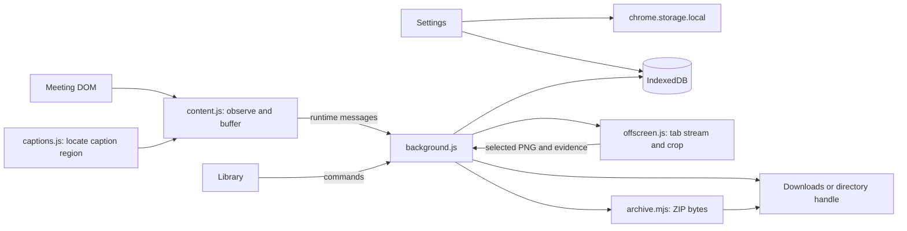

# Kiến trúc

[English](../en/architecture.md) · [Tài liệu](../README.md)

MeetScribe là tiện ích Chrome Manifest V3. Mã trong `extension/` chạy trực tiếp, không cần bundler sản phẩm hoặc thư viện runtime. Nội dung dưới đây mô tả bản 1.2.0.

## Thành phần và luồng dữ liệu

| Thành phần | Trách nhiệm |
| --- | --- |
| [background.js](../../extension/background.js), [commands.mjs](../../extension/commands.mjs) | Định tuyến thông điệp, tuần tự hóa bắt đầu/dừng theo tab, theo dõi frame, chốt phiên và lên lịch xuất |
| [content.js](../../extension/content.js) | Thanh nổi Shadow DOM, quan sát phụ đề gốc, hàng đợi lô trong bộ nhớ, chọn vùng thủ công và kiểm tra nguồn |
| [captions.js](../../extension/captions.js), [captions.mjs](../../extension/captions.mjs) | Bộ nhận diện classic script để inject và module wrapper cho test; chấm điểm vùng caption đang hiện, từ chối nguồn mơ hồ/không liên quan |
| [store.mjs](../../extension/store.mjs) | Giao dịch IndexedDB, tệp phiên, directory handle, đọc đúng phiên và giới hạn đầu vào ZIP |
| [downloads.mjs](../../extension/downloads.mjs), [destination.mjs](../../extension/destination.mjs) | Xác nhận lượt tải hoặc ghi qua directory handle trước khi đánh dấu tệp journal đã xuất |
| [archive.mjs](../../extension/archive.mjs) | Cấu trúc ZIP, CRC-32, nén native tùy chọn, transcript/hướng dẫn AI và manifest entry |
| [offscreen.js](../../extension/offscreen.js), [visual.mjs](../../extension/visual.mjs) | Nhận luồng video tab tạm, cắt vùng chọn, so sánh ảnh, áp dụng nhịp lấy mẫu/hạn mức và dừng tracks |
| [frames.mjs](../../extension/frames.mjs), [install.mjs](../../extension/install.mjs) | Chọn frame họp hỗ trợ, inject bộ thu, định tuyến và quy đổi tọa độ iframe Zoom |
| [library.js](../../extension/library.js), [settings.js](../../extension/settings.js) | Điều khiển/xem trước/xuất phiên, cài đặt giao diện, chọn thư mục và sửa quyền |

Shadow DOM cách ly kiểu hiển thị, **không** cách ly mã không đáng tin. Trang họp kiểm soát DOM được quan sát. Không coi thanh nổi là ranh giới bảo mật hoặc caption là dữ liệu được xác thực mật mã.

## Phiên và thông điệp

Trạng thái lưu bền của phiên là `recording`, `stopping`, `completed` và `interrupted`. Nhãn chờ/đang khởi tạo thuộc trạng thái giao diện. Tiến độ xuất tách riêng: tệp chờ và `exportError` có thể còn dù phiên đã kết thúc.

Content script và trang tiện ích dùng `chrome.runtime.sendMessage`/`chrome.tabs.sendMessage`, không giữ port dài hạn. Ví dụ tên lệnh worker thực tế: `start`, `stop`, `caption`, `mark`, `health`, `retry` và `export-zip`. Trang Cài đặt cũng trực tiếp đọc/ghi cấu hình cục bộ và directory handle trong ngữ cảnh trang tiện ích.

## Lưu bền

Database `meetscribe-local-v1`, schema phiên bản 2, có ba object store:

- `sessions`: metadata phiên, khóa là mã phiên.
- `files`: payload JSONL/PNG/JSON, khóa `<mã-phiên>/<tên-tệp-tương-đối>`. Index `pending` dùng `[sid, state]`.
- `destination_handles`: directory handle và bản ghi nơi lưu đang chọn.

Caption/ảnh/sự kiện là tệp trong `files`, không phải các store IndexedDB riêng. Đọc tệp phiên dùng **khoảng tiền tố chuỗi** (`id + '/'` đến `id + '/\uffff'`). Đọc dữ liệu xuất dùng cursor đúng phiên và từ chối khi lượng payload tích lũy quá lớn. Độ mờ/cỡ chữ và cấu hình tương tự dùng các khóa `chrome.storage.local` riêng.

Hàng đợi content chỉ bỏ lô caption sau khi nhận xác nhận journal bền vững. Worker sau đó thử xuất ra đĩa. Trạng thái xuất tệp đổi sau khi Chrome báo tải hoàn tất hoặc đóng writable stream thành công. `finished.json` được ghi vào journal khi chốt, không bảo đảm xuất đĩa thành công. Xem [định dạng xuất](export-format.md).

## Lấy dữ liệu và nhịp xử lý

Lô caption thường xả sau 10 giây hoặc 100 cập nhật. Kiểm tra nguồn mỗi 5 giây; màn hình kết thúc được nhận diện phải xuất hiện trong hai lần liên tiếp khi không còn nút rời họp. Chỉ im lặng không kết thúc phiên. Chrome alarm thử lại tệp chờ mỗi phút, không phải bộ đếm xả lô caption.

Sau khi chọn vùng share rõ ràng, `background.js` lấy mã luồng tab capture. `offscreen.js` dùng `getUserMedia({audio:false,...})` để nhận **luồng toàn tab trong bộ nhớ**, rồi cắt vùng đã xác nhận trước khi lưu PNG. Khung so sánh nhỏ được giữ trong RAM để loại trùng cho đến lúc dừng hẳn. Lấy mẫu tự động mỗi 15 giây, thường cách ít nhất 30 giây giữa các ảnh lưu. Đánh dấu và xét thay đổi ổn định vẫn chịu kiểm tra trùng/hạn mức.

## ZIP và hành vi khi lỗi

Cấu trúc header/central directory ZIP và CRC-32 viết bằng JavaScript. Khi sẵn có và có lợi, Deflate dùng `CompressionStream('deflate-raw')` native của trình duyệt; nếu không, có thể lưu entry không nén. Manifest có đường dẫn và số byte, không có băm SHA-256. Giới hạn payload đầu vào/nội dung sinh thêm là 500 MiB, không cam kết mức RAM đỉnh cố định.

Nơi lưu tùy chọn được gắn theo mã riêng cho từng phiên. Thiếu/mất quyền giữ tệp thông thường ở trạng thái chờ; người dùng có thể cấp lại quyền đúng handle hoặc cứu ZIP về Downloads. Dừng và xuất ZIP sẽ chốt/xả trước, vẫn có thể lấy journal khi xuất thông thường lỗi. Lỗi lưu trữ/trình duyệt không thể phục hồi caption chưa được quan sát hoặc chưa ghi journal. Xem [phát triển](development.md) và [xác minh](../verification.md) về test và giới hạn thủ công.
