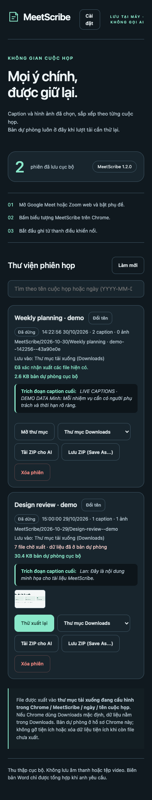

# Hướng dẫn sử dụng

**Tiếng Việt** · [English](../en/usage.md) · [Mục lục tài liệu](../README.md)

Tài liệu này hướng dẫn chi tiết quy trình sử dụng MeetScribe trong các cuộc họp, cách chụp ảnh slide trình chiếu, quản lý thư viện phiên họp và tùy biến cài đặt giao diện.

---

## Quy trình ghi chép cuộc họp

   
  <em>Thanh điều khiển nổi khi đang họp (ảnh chụp minh họa với phụ đề mô phỏng trên Google Meet).</em>

### Bước 1: Bật phụ đề trước khi bắt đầu
Trước khi bật MeetScribe, bạn phải bật tính năng phụ đề trực tiếp của nền tảng họp:
- **Google Meet:** Bấm vào biểu tượng phụ đề (**CC**) ở thanh điều khiển dưới cùng.
- **Zoom Web:** Bấm vào nút **Phụ đề** (Captions / Show Captions) trên thanh điều khiển.

> **Quan trọng:** MeetScribe thu thập văn bản từ DOM do công nghệ nhận diện giọng nói của chính Google Meet / Zoom tạo ra. Tiện ích không ghi âm micro và không tự chạy AI nhận diện giọng nói. Nếu bạn chưa bật phụ đề, tiện ích sẽ không có dữ liệu để thu nhận.

### Bước 2: Mở thanh điều khiển
Bấm vào biểu tượng **MeetScribe** trên thanh tiện ích Chrome. Thanh điều khiển kính mờ nổi sẽ xuất hiện ngay trên tab cuộc họp.

### Bước 3: Các nút điều khiển trên thanh nổi

Giao diện tiện ích hoàn toàn bằng tiếng Việt. Bảng dưới đây giải thích chi tiết chức năng và hành vi của từng nút:

| Tên nút trên giao diện | Ý nghĩa tiếng Anh | Chức năng & Hành vi cụ thể |
| :--- | :--- | :--- |
| `Bắt đầu ghi` | **Start recording** | Bắt đầu phiên thu thập. Tiện ích tự động tìm khung phụ đề và tạo phiên trong IndexedDB. |
| `Đang chuẩn bị…` | **Preparing…** | Trạng thái tạm thời khi tiện ích đang khởi tạo cơ sở dữ liệu và siêu dữ liệu phiên. |
| `Dừng và lưu` | **Stop and save** | Dừng ghi, xả toàn bộ bộ đệm phụ đề chờ, chốt phiên và xuất các tệp ra ổ đĩa. |
| `Đang lưu…` | **Saving…** | Trạng thái tạm thời khi đang hoàn tất việc ghi các tệp nhật ký cuối cùng ra ổ đĩa. |
| `Vùng caption` | **Caption region** | Bộ chọn thủ công dự phòng. Kích hoạt chế độ kiểm tra phần tử bằng chuột để chỉ định khung phụ đề. |
| `Vùng share` | **Share region** | Yêu cầu bạn click chọn vùng nội dung trình chiếu. Bắt đầu lấy mẫu khung hình video trong bộ nhớ. |
| `Ngừng chụp vùng share` | **Stop capturing share region** | Ngừng lấy mẫu ảnh slide nhưng vẫn tiếp tục thu thập phụ đề bình thường. |
| `Đánh dấu` | **Mark / Bookmark** | Lưu ngay một mốc thời gian thảo luận vào `events/` và thử chụp một ảnh slide tại thời điểm đó. |
| `Thu nhỏ` (`-`) | **Collapse** | Thu nhỏ thanh nổi thành một viên thuốc trạng thái nhỏ gọn (`Mở rộng MeetScribe`). Bấm lại để mở. |
| `Di chuyển thanh điều khiển` | **Move toolbar** | Bấm và kéo biểu tượng mũi tên 4 hướng, hoặc dùng phím `Tab` tới nút rồi nhấn các phím mũi tên. |
| `Cài đặt MeetScribe` | **Settings** | Mở trang `settings.html` để chỉnh độ mờ, cỡ chữ hoặc cấu hình thư mục lưu trữ. |
| `Thư viện phiên họp` | **Session library** | Mở trang `library.html` để xem lại, đổi tên, xuất lại hoặc tải gói ZIP cho AI. |
| `Thử lưu và tiếp tục` | **Retry and continue** | Nút cứu hộ hiển thị khi lượt ghi file gặp lỗi tạm thời. |
| `Cứu caption đang chờ` | **Rescue pending captions** | Tải về trình duyệt khẩn cấp nếu ngữ cảnh tiện ích Chrome bị vô hiệu hóa hoặc bị reload. |

---

## Chụp ảnh slide trình chiếu (`Vùng share`)

Khi có người bắt đầu chia sẻ màn hình hoặc slide:
1. Bấm nút **`Vùng share`** trên thanh nổi.
2. Rê chuột vào đúng khung chữ nhật của slide trình chiếu và click xác nhận.
   - **Tuyệt đối không** chọn toàn bộ cửa sổ trình duyệt hoặc vùng chứa camera người tham gia.
   - Chrome sẽ hiện thông báo xin quyền tab capture; hãy chấp nhận để tiếp tục.
3. **Quy tắc lấy mẫu ảnh:**
   - MeetScribe lấy mẫu luồng video ngầm mỗi **15 giây**.
   - Ảnh mới chỉ được lưu nếu khác biệt rõ rệt so với ảnh trước (được đánh giá bằng mã băm cảm nhận dHash64, độ lệch màu RGB và sai khác lưới 8&times;8).
   - Khoảng cách thông thường giữa 2 ảnh được lưu là ít nhất **30 giây** (trừ khi bạn chủ động bấm `Đánh dấu`).
4. **Hạn mức an toàn:** Tối đa 30 ảnh trong 1 giờ, 120 ảnh cho mỗi phiên và giới hạn 100 MiB tổng dung lượng ảnh.
5. Nếu người trình chiếu tắt share hoặc che khung hình, thanh nổi sẽ báo: *"Mất vùng share. Chọn lại vùng share; caption vẫn tiếp tục."* Việc thu phụ đề vẫn diễn ra liên tục.

---

## Thư viện phiên họp (`library.html`)

   
  <em>Trang Thư viện phiên họp (ảnh chụp minh họa hiển thị trạng thái xuất, dung lượng bản dự phòng và nút ZIP).</em>

Thư viện liệt kê toàn bộ các cuộc họp đã ghi được lưu trong bản dự phòng IndexedDB:
- **Thanh tìm kiếm (`Tìm theo tên cuộc họp hoặc ngày…`):** Lọc theo tên hoặc ngày (`YYYY-MM-DD`).
- **`Đổi tên` (Rename):** Đổi tên hiển thị trong siêu dữ liệu. Thao tác này **không** di chuyển hay đổi tên các tệp đã xuất trên đĩa.
- **Xem trước trích đoạn & ảnh:** Hiển thị vài dòng phụ đề cuối cùng và các ảnh thu nhỏ của slide.
- **Dung lượng dự phòng:** Thể hiện số byte dữ liệu đang lưu an toàn trong IndexedDB của Chrome.
- **`Thử xuất lại` (Retry export):** Thử ghi lại các tệp chưa xuất ra đĩa nếu lượt tải trước đó bị gián đoạn.
- **`Cấp lại quyền thư mục` (Reauthorize folder):** Cấp lại quyền truy cập nếu thư mục đã lưu không còn quyền ghi.
- **`Tải ZIP cho AI` (Download AI ZIP):** Tạo tệp nén ZIP độc lập chứa đầy đủ tệp thô, `transcript.md` và `README-for-AI.md`.
- **`Lưu ZIP (Save As...)` (Save ZIP As...):** Kích hoạt hộp thoại lưu của hệ điều hành để bạn chọn nơi lưu tệp ZIP.
- **`Xóa phiên` (Delete session):** Xóa vĩnh viễn bản sao lưu trong IndexedDB sau khi xác nhận. **Thao tác này KHÔNG xóa các tệp đã xuất trên ổ đĩa của bạn.**

   
  <em>Giao diện thư viện thích ứng trên màn hình hẹp.</em>

---

## Cài đặt (`settings.html`)

   
  <em>Trang Cài đặt hiển thị các thanh trượt tùy biến giao diện và tùy chọn vị trí lưu trữ.</em>

### 1. Giao diện thanh nổi (`Giao diện thanh nổi`)
- **Độ mờ nền thanh nổi (`Độ mờ nền thanh nổi`):** Kéo thanh trượt từ 40% (trong suốt hơn) đến 100% (đậm hoàn toàn). Chỉ thay đổi alpha của nền kính mờ; chữ luôn giữ độ tương phản 100%. Giá trị mặc định là **96%**.
- **Cỡ chữ hiển thị (`Cỡ chữ hiển thị`):** Kéo thanh trượt từ 12px đến 18px. Toàn bộ các nút và biểu tượng co giãn đồng bộ theo tỷ lệ. Mặc định là **14px**.
- **`Đặt lại mặc định` (Reset to default):** Đưa độ mờ về 96%, cỡ chữ về 14px và chuyển thanh nổi về góc trên bên trái.

### 2. Vị trí lưu trữ dữ liệu (`Vị trí lưu trữ dữ liệu`)
- **`Thư mục Tải xuống (Downloads)`:** Mặc định. Tự động lưu các tệp vào thư mục Downloads của Chrome theo đường dẫn `MeetScribe/YYYY-MM-DD/...`.
- **`Thư mục cục bộ tùy chọn` (Custom directory):** Bấm **`Chọn thư mục…`** để chọn bất kỳ thư mục nào trên ổ cứng thông qua File System Access API.
- **Ghim thư mục theo phiên:** Thay đổi cấu hình chỉ áp dụng cho các phiên họp **trong tương lai**. Các phiên cũ luôn giữ nguyên thư mục đã ghim ban đầu. Nếu phiên cũ bị mất quyền ghi, hãy dùng nút **`Cấp lại quyền ghi cho thư mục này`**.

Để tìm hiểu chi tiết cấu trúc các tệp được lưu và cách nạp vào AI, xem tiếp mục [Cấu trúc file xuất](export-format.md).

## Ví dụ cửa sổ hẹp

[Xem ảnh thư viện cửa sổ hẹp](../images/library-mobile.png). Đây là bố cục co giãn trong Chrome máy tính, không phải hỗ trợ tiện ích Chrome trên điện thoại. Toàn bộ nội dung ảnh là giả lập; xem [nguồn ảnh](../images/README.md).
